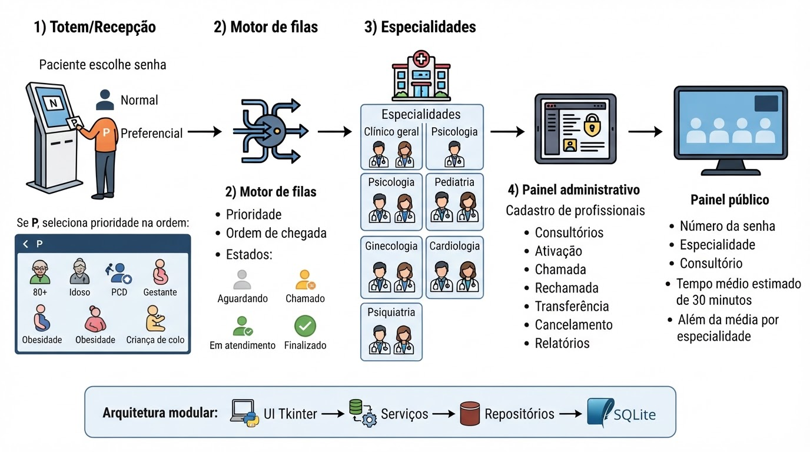

# 🏥 MedPass — Sistema de Gerenciamento de Senhas para Clínica Médica

## 👥 Integrantes do Projeto
* **Maria Eduarda Martins** — RGM 49856731
* **Ingrid Alexandre** — RGM 41160134
* **Lays Martins** — RGM 46011725

---

## 📌 1. Descrição da Situação-Problema
Em ambientes de atendimento de saúde, a organização eficiente do fluxo de pacientes é um fator crítico para a qualidade do serviço. A ausência de um controle rígido e automatizado de filas pode causar atrasos, falta de transparência no tempo de espera e o descumprimento de critérios de prioridade garantidos por lei ou estabelecidos por protocolos institucionais. 

Diante disso, surge a necessidade de um software capaz de gerenciar a emissão de senhas, classificar prioridades de forma automatizada, separar o fluxo por especialidades médicas e informar com clareza o tempo estimado de espera para cada paciente.

---

## 🎯 2. Objetivo do Sistema
Desenvolver um sistema desktop de gerenciamento e triagem de senhas para uma clínica médica. O programa simula todo o fluxo de atendimento — desde a recepção e escolha de especialidade até a chamada para a consulta —, aplicando conceitos fundamentais da ciência da computação como estruturas de dados lineares e de prioridade, programação orientada a objetos (POO), arquitetura guiada por eventos e interface gráfica amigável.

---

## 🛠️ 3. Tecnologias e Bibliotecas Utilizadas
* **Linguagem de Programação:** [Python 3.x](https://www.python.org/)
* **Interface Gráfica (GUI):** `Tkinter` (Biblioteca padrão do Python)
* **Estruturas de Dados:** `collections.deque` / Módulos nativos para manipulação de listas e ordenação
* **Controle de Versão:** Git e GitHub

---

## 🧠 4. Estruturas de Dados Implementadas
O sistema **não simula visualmente** a movimentação dos dados, mas realiza operações reais de inserção, remoção e consulta sobre estruturas de dados em memória:

1. **Fila FIFO (First In, First Out):**
   * **Aplicação:** Utilizada para organizar pacientes do atendimento **Normal (N)** e garantir que pacientes de uma mesma categoria de prioridade sejam atendidos rigorosamente pela ordem de chegada.
   * **Operações:** `enqueue` (inserção ao fim da fila) e `dequeue` (remoção do primeiro elemento).

2. **Fila de Prioridades (Priority Queue):**
   * **Aplicação:** Utilizada para classificar e intercalar os atendimentos **Prioritários (P)**. A seleção considera a categoria do paciente (conforme tabela abaixo) antecedendo a fila comum.
   * **Hierarquia de Prioridades Utilizada:**
     1. Pacientes com 80 anos ou mais
     2. Pacientes idosos (60 a 79 anos)
     3. Pessoas com Deficiência (PCD)
     4. Gestantes
     5. Pessoas com Obesidade
     6. Acompanhantes de criança de colo

---

## ✨ 5. Funcionalidades Disponíveis

- [x] **Cadastro de Especialidades:** Permite cadastrar até 3 especialidades médicas simultâneas (Clínica Geral, Pediatria, Ginecologia, Cardiologia, Psiquiatria) com validação contra duplicidades.
- [x] **Emissão de Senhas:** Gera identificadores sequenciais únicos por especialidade e tipo (Ex: `C1-N001`, `C1-P002`, `C2-N001`).
- [x] **Chamada de Pacientes:** Seleciona e remove automaticamente o próximo paciente da fila, respeitando a ordem de prioridade.
- [x] **Consulta de Filas:** Exibe o quantitativo de pessoas aguardando e a ordem prevista de chamada atualizada em tempo real.
- [x] **Cálculo de Tempo Estimado:** Calcula o tempo de espera estimado considerando **30 minutos por atendimento** para os pacientes posicionados à frente na fila:
  $$\text{Tempo Estimado} = \text{Quantidade de Pacientes à Frente} \times 30\text{ min}$$
- [x] **Painel de Atendimento Dinâmico:** Exibe a última senha chamada e atualiza as contagens gerais.


---

## 📊 Arquitetura e Planejamento Dinâmico

<p align="center">
  
</p>

### 📚 Documentação e Especificações Técnicas
Todo o projeto foi estruturado com base em um planejamento modular detalhado, contemplando o escopo funcional, o modelo de banco de dados SQLite e o backlog do MVP. Você pode acessar o documento completo na raiz do repositório:
- **Arquivo:** [Baixar Documento](./docs/planejamento_sistema_senhas_clinica.docx)

---

## 🚀 6. Instruções para Executar o Programa

### Pré-requisitos
* Ter o **Python 3.x** instalado em seu computador.

### Passo a Passo

1. **Clonar o repositório:**
   ```bash
   git clone [https://github.com/w-Eduarda/sistema-senhas-hospitalar.git](https://github.com/w-Eduarda/sistema-senhas-hospitalar.git)

```

2. **Acessar a pasta do projeto:**
```bash
cd NOME-DO-REPOSITORIO

```


3. **Executar a aplicação:**
```bash
python main.py

```


*(Nota: O Tkinter já vem instalado por padrão com o Python na maioria dos sistemas operacionais).*

---

## 🖼️ 7. Imagens da Interface Gráfica

| Tela Principal (Menu) | Emissão de Senhas |
| --- | --- |
|  |  |

| Gerenciamento / Chamada de Filas | Painel de Atendimento |
| --- | --- |
|  |  |

---

## 🎥 8. Vídeo Demonstrativo

Confira a demonstração completa do funcionamento do sistema, navegação pelas telas e explicação do código no vídeo abaixo:

▶️ **[Clique aqui para assistir ao vídeo demonstrativo do sistema no YouTube](https://www.youtube.com/watch?v=SEU-VIDEO-AQUI)**

```
